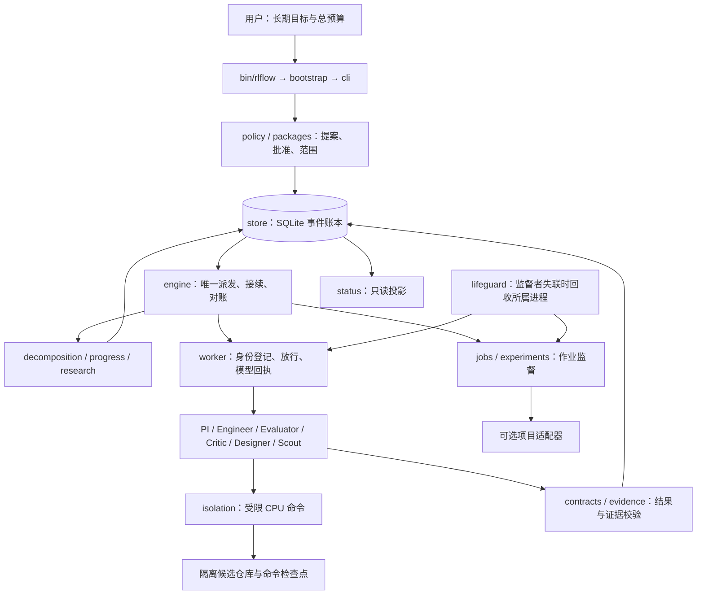

# 架构与数据流

rlflow 采用确定性调度器、短生命周期模型角色、追加事件账本和独立进程监督。用户定义目标、完成条件、可写范围、保护边界与总预算；PI 在批准边界内动态拆分任务。调度器验证并执行角色建议，角色本身没有批准和嵌套派工权限。

## 分层

保留现有扁平 Python 包布局，因为冻结发布、角色定位及测试均依赖它。图中为逻辑分层，不为整理文档而改动运行时导入结构。

## 角色

| 角色 | 主要职责 | 边界 |
| --- | --- | --- |
| PI | 解释目标、分解、根据证据选择下一步 | 不能自我批准、实现代码或扩大预算 |
| Engineer | 在允许模块内实现和返工 | 不能修改冻结验收标准 |
| Evaluator | 独立验证、建立条件与原始证据的对应 | 不修改被评实现 |
| Critic | 找竞争解释、诊断停滞、提出可判别假设 | 不直接执行产品变更 |
| Designer | 将假设转换成实验规格 | 不能赋予规格运行权限 |
| Scout | 围绕明确问题检索和比较候选 | 受咨询频率、来源及数量限制 |

`roles/*.toml` 是实际加载的角色定义；`roles/*.md` 是保留的历史材料。模型选择单独由 `model_policy.yaml` 管理，不把角色身份与固定模型混在一起。每次会话冻结模型、推理级别、角色、schema、输入和控制代码。

## 长期工程循环

目标 → 精确提案 → 用户批准一次 → PI 分解 → 校验范围和依赖 → Engineer 实现 → Evaluator 检查。FAIL 在原预算内返工；证据停滞进入 Critic/新 PI 诊断。子任务完成后接续依赖；父任务回到集成检查，全部目标条件有相应证据才结束。

`--goal-file` 无需事先列出全部子任务。`decomposition` 限定任务数和深度，所有后继任务共享范围、保护边界和预算。当前实现同一父任务只拆分一次，更细分解通过未完成子任务进行。独立分支可绕过受阻分支；当前角色执行仍串行。

## 研究循环

Critic 提出最多三个假设 → Designer 选择完整实验规格 → 授权校验后 Runner 执行 → 独立 Evaluator 评估 → Fresh PI 决策。工程启动失败不计有效科学实验。负结果保留；按周期安排先原始证据、后 PI 解释的 Cold Review。方法、评价或主架构改变仍须匹配相应批准。

## 证据与状态

`store.py` 的 SQLite 追加事件是权威记录，导出的 JSON 视图便于查看和恢复。会话包含 session/task/cycle/state 身份和候选哈希；不匹配的输出拒绝接受。进展绑定冻结条件及实质证据，换报告措辞、候选注释或测试数量本身不构成进展。

上下文由 `context.py`、`evidence.py` 和 engine 的 packet 构建逻辑形成有界输入；按需材料带权限、来源、大小和哈希校验。默认包不持续累加完整角色输出。

## 当前限制

这是现有实现的架构整理，不是生产可靠性认证。复制时已知启动放行约 10 秒的握手边界可能超时；本次未修复该行为。全套 H1/GPU 接入不是通用核心；独立副本不带外部 Runner。离线通过不保证真实模型能完全无人干预完成任意长期目标。
